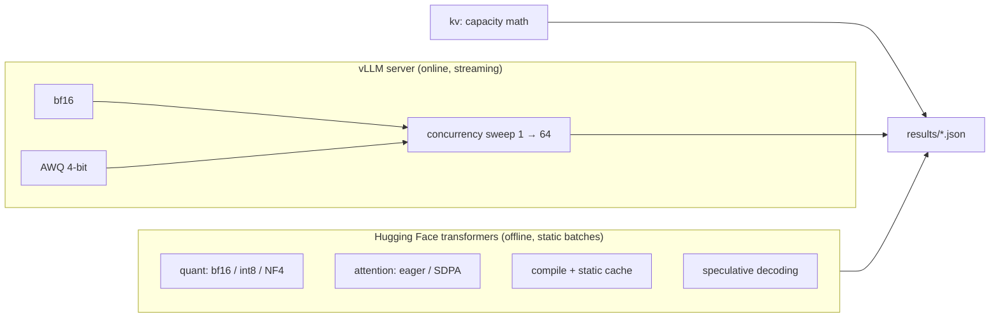

# llm-inference-optimization: what actually makes LLM serving faster

[](https://github.com/kishorhange111/llm-inference-optimization/actions/workflows/ci.yml)


Measured experiments on the main inference optimisations for Qwen2.5 models on one GPU: quantisation, attention kernels, `torch.compile` with a static KV cache, speculative decoding, KV-cache capacity planning, and continuous batching with vLLM. Every speed number comes with a quality number, because a faster model that answers worse is not an optimisation.

**Author:** Kishor Hange

<!-- RESULTS:START -->
## Results

_The Colab runs for this section are in progress. It will hold: bf16 vs. int8 vs. NF4 (memory, throughput at batch 1/8/32, WikiText-2 perplexity), eager vs. SDPA attention up to 8k-token prompts, compile + static cache at batch 1, speculative decoding speed-up and acceptance with a 0.5B draft model, KV-cache capacity tables, and a vLLM concurrency sweep (bf16 vs. AWQ 4-bit) with TTFT/TPOT percentiles._
<!-- RESULTS:END -->

## The metrics

| Metric | What it measures | Dominated by |
|---|---|---|
| **TTFT**, time to first token | How long a user waits before text appears | Prefill: one forward pass over the whole prompt (compute-bound) |
| **TPOT**, time per output token | How fast text streams after that | Decode: one pass per token that reads every weight (memory-bandwidth-bound) |
| **Throughput** | Generated tokens per second across all requests | Batch size, and whether new requests can join a running batch |
| **Quality** | WikiText-2 perplexity; identical outputs for speculative decoding | Whether the optimisation changed the model |

Larger batches raise throughput but slow each request; quantisation lowers TPOT because fewer bytes are read per token. The experiments make these trade-offs visible.

## Experiments



| Experiment | Model | Question it answers |
|---|---|---|
| `quant` | Qwen2.5-7B-Instruct | How much memory and speed do LLM.int8() and NF4 save, and what do they cost in perplexity? |
| `attention` | Qwen2.5-1.5B-Instruct | How much do fused SDPA kernels help as prompts grow to 8k tokens? |
| `compile` | Qwen2.5-1.5B-Instruct | What does removing Python overhead per decode step buy at batch size 1? |
| `speculative` | 7B target, 0.5B draft | How many tokens does each target forward pass accept, and is the output unchanged? |
| `kv` | five model shapes | How many 4k-token conversations fit on a 40 GB A100, with and without GQA, fp8 KV and 4-bit weights? |
| `serve` | 7B bf16 and AWQ in vLLM | How do throughput, TTFT and TPOT change from 1 to 64 concurrent users? |

## Measurement rules

Each rule prevents a common way benchmarks mislead:

- **Warm up** every configuration (both the 1-token and full-length shapes) before timing, so CUDA set-up and compilation are not counted.
- **Synchronise only at the ends** of a timed region. Syncing inside the decode loop would slow the loop being measured. TTFT is timed as a separate `max_new_tokens=1` run on the same batch.
- **Fixed output length** (`min_new_tokens = max_new_tokens`, `ignore_eos` in vLLM), so an early end-of-sequence token can't make one configuration look faster.
- **Same prompts everywhere**, built as token ids so every request has exactly the stated length.
- **Closed-loop load** for serving: exactly C requests in flight at concurrency C, each streaming its answer. Throughput is total tokens over wall-clock time.
- **Quality next to speed**: perplexity with a sliding window for quantisation; greedy speculative decoding must produce identical output to the target model alone.

## Quickstart

```bash
pip install -e ".[gpu]"
python scripts/run_experiments.py kv                                    # no GPU needed
python scripts/run_experiments.py quant --model Qwen/Qwen2.5-7B-Instruct
python scripts/run_experiments.py speculative --model Qwen/Qwen2.5-7B-Instruct --draft Qwen/Qwen2.5-0.5B-Instruct

# online serving
vllm serve Qwen/Qwen2.5-7B-Instruct --max-model-len 4096 &
python scripts/run_experiments.py serve --model Qwen/Qwen2.5-7B-Instruct --label bf16
```

`scripts/colab_job.sh` runs everything on one Colab A100 runtime, including starting and stopping the vLLM server. A failed experiment is logged and the rest still run.

## Project layout

```
src/infopt/
├── kv_cache.py     KV-cache and weight memory math, capacity planning
├── stats.py        TTFT / TPOT / throughput, percentiles
├── hf_bench.py     model loading (bf16 / int8 / NF4, eager / SDPA, compile), benchmarks, perplexity, speculative decoding
└── serve_bench.py  async streaming load generator for OpenAI-compatible servers
scripts/            experiment runner, Colab job
```

## Tests

`pytest` runs on CPU without downloads: the KV-cache formula against a hand calculation, GQA savings, capacity planning, timing statistics, SSE parsing, a concurrency sweep against a fake streaming server, and the offline benchmark and perplexity code on a tiny GPT-2.

## Limitations

- One GPU per run (Colab); tensor-parallel serving across GPUs is not measured.
- In a static batch every request finishes together, so offline percentiles are over batches; tail latency comes from the vLLM sweep.
- Results are for one GPU type and one model family; ratios transfer better than absolute numbers.

## License

MIT
