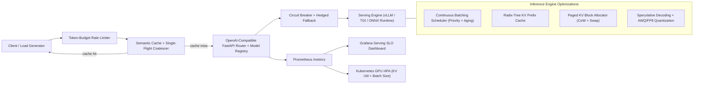

# llm-inference-optimization: Production LLM Inference Systems & Serving Optimization

[](https://github.com/kishorhange111/llm-inference-optimization/actions/workflows/ci.yml)


End-to-end LLM inference optimization library, serving control plane, and benchmarking suite: KV-cache capacity math & PagedAttention block allocator, iteration-level continuous batching scheduler, RadixAttention prefix caching, lossless speculative decoding, INT8/INT4/FP8/AWQ/GPTQ quantization calibration, ONNX Runtime / Optimum export, OpenAI-compatible FastAPI inference router with circuit breakers, token-budget rate limiting, semantic caching & single-flight request coalescing, Prometheus/Grafana observability, CI regression gates, and Kubernetes GPU/HPA manifests.

**Author:** Kishor Hange

## Architecture



<!-- RESULTS:START -->
## Measured & Simulated Results

### 1. KV-cache capacity planning (`python scripts/run_experiments.py kv`)

How many 4,096-token conversations fit in an A100-40GB once the weights are loaded, from each model's real layer count, KV heads, and head size ([`results/kv.json`](results/kv.json)):

| Model | KV cache per token (bf16) | 32 × 4k-token batch | Weights (bf16) | 4k sequences that fit, bf16 | with 4-bit weights + fp8 KV |
|---|---:|---:|---:|---:|---:|
| Qwen2.5-0.5B | 12 KiB | 1.5 GiB | 0.9 GiB | 748 | 1526 |
| Qwen2.5-1.5B | 28 KiB | 3.5 GiB | 2.9 GiB | 302 | 645 |
| Qwen2.5-7B | 56 KiB | 7.0 GiB | 14.2 GiB | 99 | 296 |
| Llama-3.1-8B | 128 KiB | 16.0 GiB | 15.0 GiB | 42 | 129 |
| Llama-2-7B (no GQA) | 512 KiB | 64.0 GiB | 12.6 GiB | 11 | 32 |

Grouped-query attention is the single largest architectural lever: Llama-2-7B (32 KV heads) needs 512 KiB/token while Qwen2.5-7B (4 KV heads) needs 56 KiB/token (9× more concurrent conversations on the same GPU). Quantizing weights to 4-bit and KV cache to FP8 roughly triples capacity again (99 → 296 concurrent 4k sequences).

### 2. Deterministic CPU Smoke Suite (`python -m infopt.regression_cli run`)

Committed CI regression baseline ([`results/smoke_baseline.json`](results/smoke_baseline.json)):

| Subsystem | Metric | Observed Value |
|---|---|---:|
| Continuous Batching Scheduler | Output throughput (mixed lengths) | **281.6 tok/s** (`2.03×` vs static) |
| Continuous Batching Scheduler | TTFT p95 / TPOT p95 | **651.7 ms** / **10.9 ms** |
| KV-Cache Paging (`block_size=16`) | Memory savings vs contiguous pre-alloc | **87.7%** |
| Quantization Calibration (AWQ 4-bit) | SQNR / Weight memory reduction | **21.55 dB** / **74.0%** |
| Speculative Decoding (`α=0.82, γ=5`) | Wall-clock speedup / tokens per verify | **2.61×** (`4.04 tok/pass`) |
| Radix Prefix Cache | Shared system-prompt token reuse | **97.0%** (`128/132 tok`) |

### 3. GPU Benchmarks

Offline Hugging Face & online vLLM GPU runs (`scripts/colab_job.sh`) are structured for a single A100 runtime; raw GPU latency numbers are recorded in `results/` when executed on GPU hardware.
<!-- RESULTS:END -->

## Optimization Latency, Memory & Cost Tradeoffs

| Technique | Primary Metric Improved | Memory Impact | Quality Impact | Best Workload Regime | Module |
|---|---|---|---|---|---|
| **Continuous Batching** | Throughput (`+2×`), p50/p95 E2E | Neutral | Exact (lossless) | Variable output lengths, concurrent traffic | [`src/infopt/scheduler.py`](src/infopt/scheduler.py) |
| **Paged KV + FP8 KV** | Max concurrency (`3×`) | `-50%` KV, `-88%` fragmentation | Negligible | Long-context & high-concurrency serving | [`src/infopt/kv_paging.py`](src/infopt/kv_paging.py) |
| **Radix Prefix Caching** | TTFT (`-50%` to `-95%`) | Shared blocks (CoW + LRU) | Exact (lossless) | System prompts, RAG context, multi-turn chat | [`src/infopt/prefix_cache.py`](src/infopt/prefix_cache.py) |
| **Speculative Decoding** | TPOT / E2E (`2–3×`) | `+draft model` VRAM | Exact (lossless rejection sampling) | Low concurrency (batch 1–4), high draft acceptance `α ≥ 0.7` | [`src/infopt/speculative.py`](src/infopt/speculative.py) |
| **AWQ / INT4 / FP8 Quantization** | TPOT & $/1M tokens | `-50%` to `-74%` weights | Small PPL delta (gated by SQNR & PPL checks) | Memory-bandwidth-bound decode on single GPU | [`src/infopt/quantization.py`](src/infopt/quantization.py) |
| **ONNX Runtime / Optimum** | CPU/Edge latency | Graph fusion + INT8 | Gated by logit parity & top-1 agreement | CPU / edge / Triton deployments | [`src/infopt/onnx_export.py`](src/infopt/onnx_export.py) |
| **Semantic Cache + Coalescing** | Tail latency & GPU cost | Small RAM index | Tunable via cosine threshold | Repetitive FAQ / bursty duplicate queries | [`src/infopt/semantic_cache.py`](src/infopt/semantic_cache.py) |

## Quickstart

```bash
# 1. Install dev + serving dependencies (CPU-only)
pip install -e ".[dev]"

# 2. Run lint, unit tests, and CI regression smoke gate
make check

# 3. Run deterministic smoke benchmark & print Markdown report
python -m infopt.regression_cli run

# 4. Run KV-cache capacity planning table
python scripts/run_experiments.py kv

# 5. Launch OpenAI-compatible inference router + observability stack via Docker Compose
docker compose -f deploy/docker-compose.yml --profile observability up --build
```

## Project Layout

```text
llm-inference-optimization/
├── src/infopt/
│   ├── stats.py                # RequestTiming, percentiles, BenchmarkResult
│   ├── profiler.py             # TTFT/TPOT p50/p95/p99, tok/s, GPU $/1M token cost, SLO checks
│   ├── kv_cache.py             # ModelShape catalog, KV/weight memory math, capacity planning
│   ├── kv_paging.py            # PagedAttention block allocator (CoW fork, CPU swap, fragmentation)
│   ├── scheduler.py            # Static / dynamic / continuous batching with priority queues & aging
│   ├── prefix_cache.py         # Radix-tree KV prefix reuse engine with pinning & LRU eviction
│   ├── speculative.py          # Exact rejection-sampling verification, speedup & gamma optimizer
│   ├── quantization.py         # BF16/FP8/INT8/NF4/AWQ/GPTQ configs, calibration & accuracy gates
│   ├── onnx_export.py          # Optimum CLI wrapper, ORT SessionOptions & logit parity verifier
│   ├── router.py               # OpenAI-compatible FastAPI router (/v1/chat/completions, SSE) & registry
│   ├── resilience.py           # Circuit breaker, hedged fallback & per-tenant token-budget limiter
│   ├── semantic_cache.py       # Cosine-similarity response cache & async single-flight coalescer
│   ├── metrics.py              # Prometheus exporter (/metrics) for TTFT/TPOT/KV/batch/cache
│   ├── regression_cli.py       # Automated CPU smoke benchmark CLI & CI regression gate
│   ├── hf_bench.py             # GPU Hugging Face quantization/SDPA/compile/speculative runner
│   └── serve_bench.py          # Async SSE streaming concurrency load generator
├── deploy/
│   ├── docker-compose.yml      # Router + vLLM + TGI + Prometheus + Grafana profiles
│   ├── profiles/               # vLLM (Qwen2.5-7B AWQ) & TGI (Llama-3.1-8B FP8) tuning specs
│   ├── grafana/                # Grafana serving SLO dashboard JSON
│   └── k8s/                    # GPU Deployment + custom-metric HorizontalPodAutoscaler
├── docs/adr/                   # Architecture Decision Records (0001–0003)
├── results/                    # KV capacity table & CI smoke regression baseline
├── tests/                      # 100% CPU-runnable test suite (zero GPU required)
├── .github/workflows/ci.yml    # Ruff lint/format, pytest matrix, and benchmark smoke gate
├── Dockerfile                  # Multi-stage non-root inference router container
└── Makefile                    # install / lint / test / smoke / smoke-gate / check
```

## Architecture Decision Records

- [ADR-0001: Paged KV-Cache Allocation & Radix-Tree Prefix Caching](docs/adr/0001-paged-kv-and-radix-prefix-caching.md)
- [ADR-0002: Continuous Batching & Lossless Speculative Decoding](docs/adr/0002-continuous-batching-and-speculative-decoding.md)
- [ADR-0003: Quantization Quality Gates, Serving Resilience & Autoscaling](docs/adr/0003-quantization-and-serving-resilience.md)

## License

MIT
